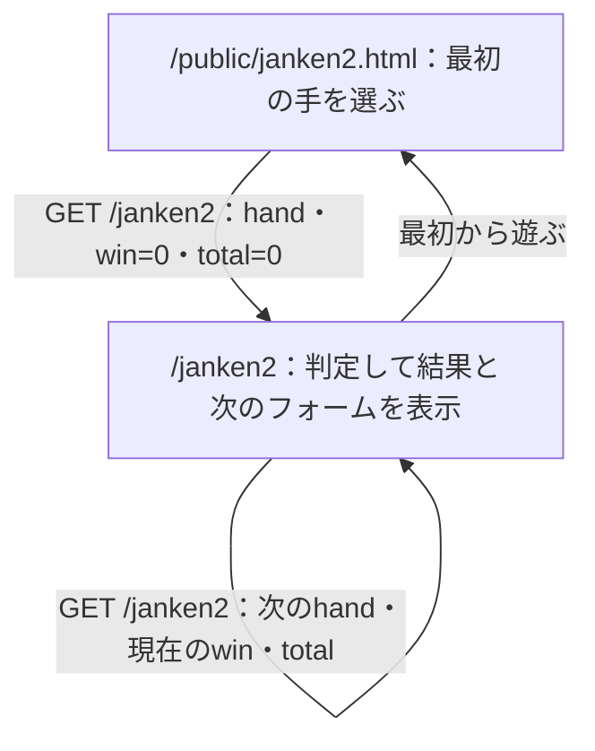

# 第7回：formの課題（資料28〜52ページ）

28〜31ページではformの送信と受け取り、33〜49ページではinputの種類を確認した。51ページの課題に合わせて、元のじゃんけんを残したままラジオボタン版を追加した。

## (1) ラジオボタン版の実装

### 変更したファイルと理由

| ファイル | 何を変更したか | なぜ変更したか |
| --- | --- | --- |
| `public/janken2.html` | 最初の入力画面を追加。グー・チョキ・パーをラジオボタンで選択し、`/janken2`へGET送信する。 | 文字を手入力する代わりに、3つから1つだけ選べるようにするため。 |
| `views/janken2.ejs` | 結果画面と、次の対戦用のラジオボタンを追加。`win`と`total`をhiddenで渡す。 | 対戦結果を表示し、成績を引き継いで続けて遊べるようにするため。 |
| `app5.js` | `/janken2`を追加。入力の受け取り、CPUの手の抽選、勝ち・負け・あいこの判定、成績の更新を行う。 | 新しいフォームの送信先が必要なため。また、元のサンプルは常に勝ちになるので、新しい版には正しい判定を実装するため。 |
| `package.json` | `npm start`の実行先を`app5.js`に変更し、`npm test`を追加。 | 元の実行先`app4.js`では今回追加したルートが使えないため。また、検証を再実行できるようにするため。 |
| `test/janken2.test.cjs` | 勝敗・成績・不正入力のテストを追加。 | CPUの手を固定して全9通りを確認し、偶然の結果に頼らず判定を検証するため。 |
| `wpro07.md` | 課題の回答と変更理由を記録。 | 実装と資料の内容を対応づけて説明するため。 |

課題の指定どおり、`public/janken.html`、`views/janken.ejs`、`app5.js`の元の`/janken`処理は変更していない。

### フォームの仕組み

3つのラジオボタンの`name`をすべて`hand`にそろえることで、同じグループの中から1つだけ選択できる。`value`には、それぞれ「グー」「チョキ」「パー」を指定した。例えばグーを選ぶと、サーバでは`req.query.hand`から「グー」を取得できる。

`required`で未選択のままの送信を防ぎ、サーバでも3種類以外の値を受け付けないようにした。

`win`と`total`はGETで文字列として届くため、`Number()`で数値に変換する。勝ったときだけ勝利数を1増やし、勝ち・負け・あいこのどの場合も対戦数を1増やす。負数や数値でない成績は400エラーにする。

hiddenは画面に表示しない入力欄であり、改ざんを防ぐ仕組みではない。今回は資料の方式に合わせて成績をhiddenで引き継いでいるため、利用者がURLを編集すれば成績を変更できる。



## (2) 起動と変更の確認

このフォルダで以下を実行する。

```sh
npm install
npm start
```

ブラウザで `http://localhost:8080/public/janken2.html` を開く。

確認した内容：

- グーを選んでからチョキを選ぶと、チョキだけが選択状態になる。
- 送信すると、自分の手・CPUの手・判定・成績が表示される。
- 結果画面からもう一度送信すると、試合数が1から2に増える。
- `npm test`は11件成功した。全9通りの勝敗、勝利数・対戦数とhiddenへの反映、不正入力、成績未指定時の初期値を確認した。
- 元のHTML・EJSに差分がなく、元の`/janken`処理も変更していないことを確認した。

GitHubへの反映結果は作業完了時のチャットに記載する。

## (3) type・name・idの働き

| 属性 | 働き | 今回の例 |
| --- | --- | --- |
| `type` | 入力欄の種類を決める。 | `radio`は選択肢、`hidden`は非表示の入力欄、`submit`は送信ボタンになる。 |
| `name` | フォームで値を送るときの項目名になる。 | `name="hand"`の値を、サーバ側の`req.query.hand`で受け取る。同じグループのラジオボタンには同じnameを使う。 |
| `id` | ページ内の要素を一意に識別する。labelとの関連づけやCSS・JavaScriptでの指定に使う。 | `id="gu"`と`label for="gu"`を対応させると、「グー」の文字をクリックしても選択できる。 |

`id`だけ付けても、その名前でフォームの値が送られるわけではない。送信する項目名には`name`を使う。また、選んだ項目から実際に送る内容は`value`で決める。

参考：[MDN input要素](https://developer.mozilla.org/ja/docs/Web/HTML/Reference/Elements/input)

## (4) HTMLファイルとEJSファイルの使い分け

HTMLファイルは、そのまま配信できる固定の画面に使う。今回の最初の入力画面は、対戦結果などを埋め込む必要がないので`public/janken2.html`にした。

EJSファイルは、サーバ側のデータを埋め込んでHTMLを作る場合に使う。今回の結果画面は、自分の手・CPUの手・判定・成績が毎回変わるので`views/janken2.ejs`にした。`res.render('janken2', データ)`でHTMLを生成し、ブラウザに返す。ブラウザが直接EJSを実行するわけではない。

例えば`<%= total %>`は現在の対戦数に置き換わる。同じテンプレートを使いながら、対戦ごとに異なる内容を表示できる。

参考：[EJS公式ドキュメント](https://ejs.co/)
